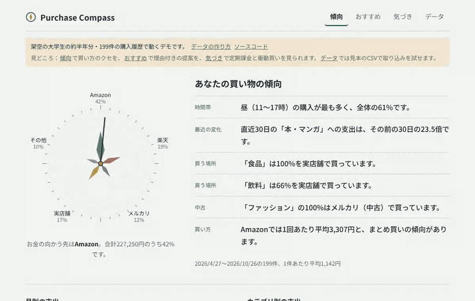
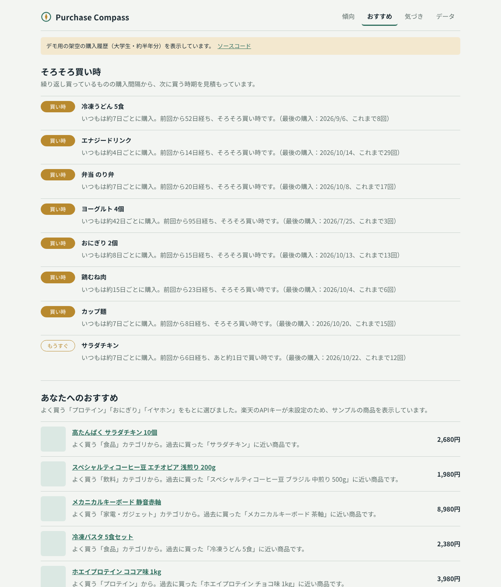
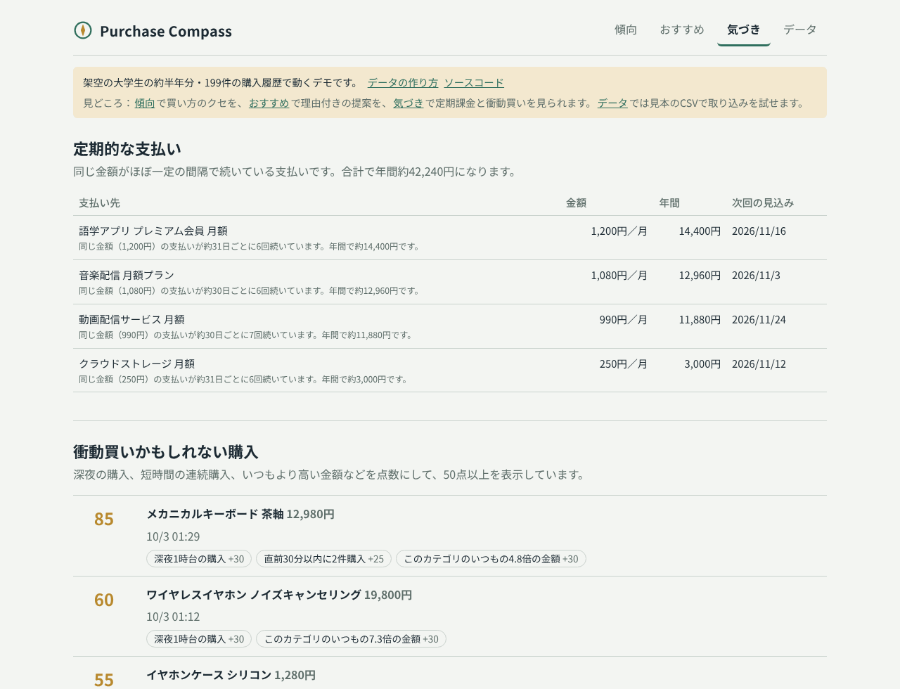
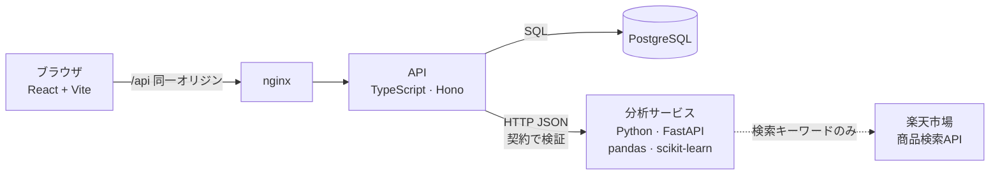

# Purchase Compass

[English](README.md) | **日本語**

[](https://github.com/kaisei467/purchase-compass/actions/workflows/ci.yml)
[](https://kaisei467.github.io/purchase-compass/)


[](LICENSE)

**Amazon・楽天・メルカリ・お店での買い物を1か所に集め、自分の買い方を文章で示し、その傾向をもとに理由付きでおすすめするWebアプリです。**

**[▶ デモを開く](https://kaisei467.github.io/purchase-compass/)**（登録不要。架空の大学生の約半年分の購入履歴を表示します。[データの作り方](docs/sample-data.md)）



## 見どころ

- **2つの言語を1つの契約でつなぐ**：画面とAPIはTypeScript、分析はPythonです。分析サービスの実際の応答を記録し、CIでTypeScript側のスキーマと照合します。片方だけ項目名を変えると、画面が壊れる前にCIが失敗します。
- **理由を必ず見せる**：傾向・おすすめ・警告のすべてに根拠を表示します（「いつもは約24日ごとに購入。前回から6日経ち、あと約18日で買い時」「深夜 +30点、いつもの4.8倍の金額 +30点」）。ブラックボックスにしないので、どのルールもテストで確かめられます。
- **チーム開発を前提にした作り**：自動テスト76件（APIは本物のPostgreSQLで検証）、CI（Python → 契約 → TypeScript → Docker）、CIが通ったときだけ動くデプロイ、[文書化した設計判断8件](docs/adr/README.md)を備えています。

## 3分で見るためのガイド

1. **触ってみる**：[デモ](https://kaisei467.github.io/purchase-compass/)で「傾向」「おすすめ」「気づき」を切り替えてください。「データ」では、お店ごとの見本CSVをダウンロードして、取り込みの読み取り結果まで試せます。
2. **全体像をつかむ**：[構成](#構成)と[技術選定の理由](#技術選定と理由)を見てください。
3. **中心のコードを読む**：
   - [`recommend.py`](services/analyzer/compass_analyzer/recommend.py)：商品の選び方と理由の出し方
   - [`importers/`](packages/shared/src/importers/)：5種類の形式を1つにまとめる処理
4. **安全装置を確認する**：
   - [契約テスト](apps/api/test/contract.test.ts)
   - [重複排除と分析キャッシュ](apps/api/src/repository.ts)
   - [CIの流れ](.github/workflows/ci.yml)

## 作った理由

自分が普段どんなものを買っているのか傾向を知り、それをもとにおすすめしてほしいと思ったのがきっかけです。

ところが、通販サイトのおすすめは、そのサイトでの購入しか見ていません。私は本をAmazon、日用品を楽天、古着をメルカリ、昼食をコンビニで買うので、どのサービスも私の本当の買い方を知りません。そこで、すべての購入を1か所に集めて傾向を分析し、理由付きでおすすめする仕組みを作りました。

## できること

| 機能 | 内容 |
| --- | --- |
| **傾向** | お店ごとの支出（コンパス）、カテゴリ別・月別の支出、曜日×時間帯のヒートマップを表示します。「「ファッション」の100%はメルカリ（中古）で買っています」のような傾向を文章で示します。信号が十分に強いときだけ表示します。 |
| **おすすめ** | **そろそろ買い時**：繰り返し買うものの購入間隔（中央値）から、次に買う時期を知らせます。**あなた向け**：楽天市場の商品検索APIで候補を取り、最近の購入との類似度で並べ、似ている過去の購入品を理由として示します。 |
| **気づき** | カード明細に埋もれた定期的な支払いを年間の金額つきで見つけます。深夜・連続・高額など、衝動買いらしい購入を点数の内訳つきで示します。 |
| **取り込み** | Amazonの公式の注文履歴を自動で認識します。それ以外のCSVや貼り付けた表は、日付・商品名・金額の列を推測し、プレビューで直してから取り込めます。同じファイルを2回取り込んでも二重になりません。 |

<p>
  
  
</p>

## 構成



- **データを持つのはTypeScriptのAPIだけ**です。取り込み・保存を担い、分析結果はデータのバージョンごとにキャッシュします。画面を開くたびではなく、データが変わったときだけ分析が走ります。
- **Pythonの分析サービスは状態を持ちません**。購入データを受け取り、結果を返すだけです。単独で再起動・台数追加ができ、データ移行も要りません。
- **一部が落ちても全体は止めません**。楽天が落ちたら同梱のカタログに切り替えます。分析サービスが落ちたり想定外の形で答えたりしたら、APIは壊れた数字を表示せず502を返します。
- **外部に出るのは検索キーワードだけ**です。購入履歴そのものはどこにも送りません。

## 技術選定と理由

| 領域 | 採用 | 理由（と採用しなかったもの） |
| --- | --- | --- |
| 言語 | TypeScript＋Python | TSは画面とAPIで型を共有できます。Pythonはデータ分析のライブラリが揃っています。1言語にすると、どちらかの利点を失います。 |
| 画面 | React、Vite、自作のSVGグラフ | 個人のダッシュボードなのでSEOもサーバー描画も不要で、Next.jsは過剰です。グラフ3つにライブラリは不要です。 |
| API | Hono、zod、postgres.js | 軽量で型安全で、Web標準のRequest/Responseに沿っています。Expressは型の支援が弱く、NestJSはこの規模には重いです。 |
| 分析 | FastAPI、pandas、scikit-learn | Pydanticの型定義からAPI仕様書が自動で生成され、契約テストに使えます。Djangoの管理画面やORMは不要です。 |
| DB | PostgreSQL | 集計・制約・トランザクションに強く、購入データは表形式のデータです。 |
| おすすめ | 文字n-gramのTF-IDF＋コサイン類似度 | 1人分の少ないデータで動き、すべての結果を説明できます。協調フィルタリングは他人のデータが必要です。生成AIは費用がかかり、データを外に出すことになり、テストもしにくいです。 |
| テスト | pytest、Node標準のテストランナー | 各言語の標準です。統合テストは本物のPostgreSQLで動かします。 |
| CI/CD | GitHub Actions、Docker | プッシュごとにCIが走り、mainでCIが通ったときだけデプロイします。 |

トレードオフを含む詳しい理由は [技術解説](docs/technical-notes.md) に、判断ごとの記録は [設計判断の記録（ADR）](docs/adr/README.md) にまとめています。

## 工夫した技術的課題

**形態素解析なしで日本語を扱う**
- 日本語は単語の間にスペースがありません。MeCabなどを入れる代わりに、2〜3文字ずつ区切る文字n-gramを使い、数行のscikit-learnで「コーヒ」「ーヒー」のような特徴を取っています。
- キーワード辞書にも落とし穴がありました。「パン」は「パンツ」に含まれるので辞書では「食パン」にし、テストで固定しています。

**2つの言語の食い違いを防ぐ**
- システムを分けたことで、片方だけ項目名を変えるという新しい失敗の形が生まれました。
- そこで、Pythonのテストが実際の応答を [`contract/`](contract/) に書き出し、TypeScriptのテストが本番と同じzodスキーマで照合する仕組みにしました。CIは毎回これを作り直します。

**何度やり直しても安全な取り込み**
- お店・日時・商品名・金額・数量からキーを作り、一意制約で保証しています。
- ファイル1つを1つのトランザクションで保存します。再取り込みでは何も増えず、失敗したら何も保存されません。

**1つの取り込み処理を2か所で使う**
- サーバーのない公開デモでも取り込みを試せるよう、取り込み処理をAPIから共有パッケージに移しました。
- 入出力を持たない純粋なTypeScriptなので、APIとブラウザが同じコードを動かします。ダウンロードできる見本がすべて問題なく読めることもテストで確かめています。

**データの取り方に誠実である**
- AmazonのAPIは継続的な売上実績が条件で、メルカリには一般向けAPIがありません。
- スクレイピングはせず、検索ページへのリンクにしました。商品の取得元は小さな部品の裏に隠したので、追加はクラス1つで済みます。

**CIが見つけたバグ**
- 型チェックの途中でできた `.js` ファイルが `.tsx` の隣に残り、Viteが古い `App.js` を読み込んで本番ビルドが壊れました。
- 手元ではlint・型・テストがすべて通っていましたが、CIのビルドとDockerのジョブが失敗して気づけました。ファイルを消し、二度と起きないよう除外ルールを追加しました。

## 起動方法

必要なのはDockerだけです。

```bash
git clone https://github.com/kaisei467/purchase-compass.git
cd purchase-compass
docker compose up --build
```

<http://localhost:8080> を開くと、初回起動時に架空のデモデータが入ります。

- **楽天の実際の商品をおすすめしたい場合**：`.env.example` を `.env` にコピーし、`RAKUTEN_APP_ID` を設定してください。未設定なら同梱のサンプルカタログを使います。
- **自分の購入履歴を分析する場合**：「データ」タブから取り込んでください。実データは `private-data/` フォルダ（Gitの管理対象外）に置けば、誤って公開されることはありません。

## テストとCI/CD

```bash
cd services/analyzer && pytest            # 35件：分析ルール、おすすめ、楽天API、HTTP、契約
npm test -w @purchase-compass/api         # 26件：取り込み、API、キャッシュ、デモモード、契約
npm test -w @purchase-compass/web         # 15件：画面の描画、公開デモのデータと見本CSVが契約どおりか
```

| ワークフロー | いつ | 何をするか |
| --- | --- | --- |
| [CI](.github/workflows/ci.yml) | プッシュ・プルリクエストごと | Pythonのlintとテスト（契約を再生成）→ TypeScriptのlint・型チェック・テスト・ビルド → Dockerのビルド |
| [Demo](.github/workflows/pages.yml) | 画面の変更がmainに入ったとき | サーバー不要のデモを作り、GitHub Pagesに公開 |
| [Deploy](.github/workflows/deploy.yml) | mainでCIが通った後 | フル構成のデプロイを起動（[手順](docs/deploy.md)） |

## フォルダ構成とドキュメント

```
apps/api/            TypeScriptのAPI：保存、分析キャッシュ、デモモード
apps/web/            React の画面（公開デモの静的版もここから作る）
packages/shared/     画面とAPIで共有する型（zod）と取り込み処理
services/analyzer/   Pythonの分析サービス：分類、傾向、習慣、おすすめ
contract/            分析サービスの実際の応答の記録（CIで照合）
samples/             デモ用の架空の購入履歴（お店ごとの形式）
```

| 文書 | 内容 |
| --- | --- |
| [技術解説](docs/technical-notes.md) | 構成、技術選定、分析ロジック、品質の全体像 |
| [設計判断の記録（ADR）](docs/adr/README.md) | 主要な判断8件の理由・他の案・受け入れたこと |
| [デモ用の購入データについて](docs/sample-data.md) | データが架空であること、作り方、デモ結果の読み方 |
| [デプロイ手順](docs/deploy.md) | フル構成を公開する方法 |
| [エラー一覧](docs/errors.md) | APIが返すエラーの種類 |

## データの取り込み元と制約

| お店 | 購入履歴 | おすすめ商品 |
| --- | --- | --- |
| Amazon | 公式の「データのリクエスト」を自動認識 | 検索リンクのみ（APIは売上実績が条件） |
| 楽天 | 購入履歴の表を貼り付け、またはCSV | 公式の商品検索API |
| メルカリ | 貼り付け、またはCSV | 検索リンクのみ（一般向けAPIなし） |
| お店・カード明細 | CSVまたは入力フォーム | — |

購入履歴を出力する非公式のブラウザ拡張もありますが、お店のログイン情報を扱うため、あえて使っていません。

## 今後

- レシート写真の読み取り（OCR）
- 商品の取得元の追加
- クリック率によるおすすめ精度の測定

## ライセンス

[MIT](LICENSE)
